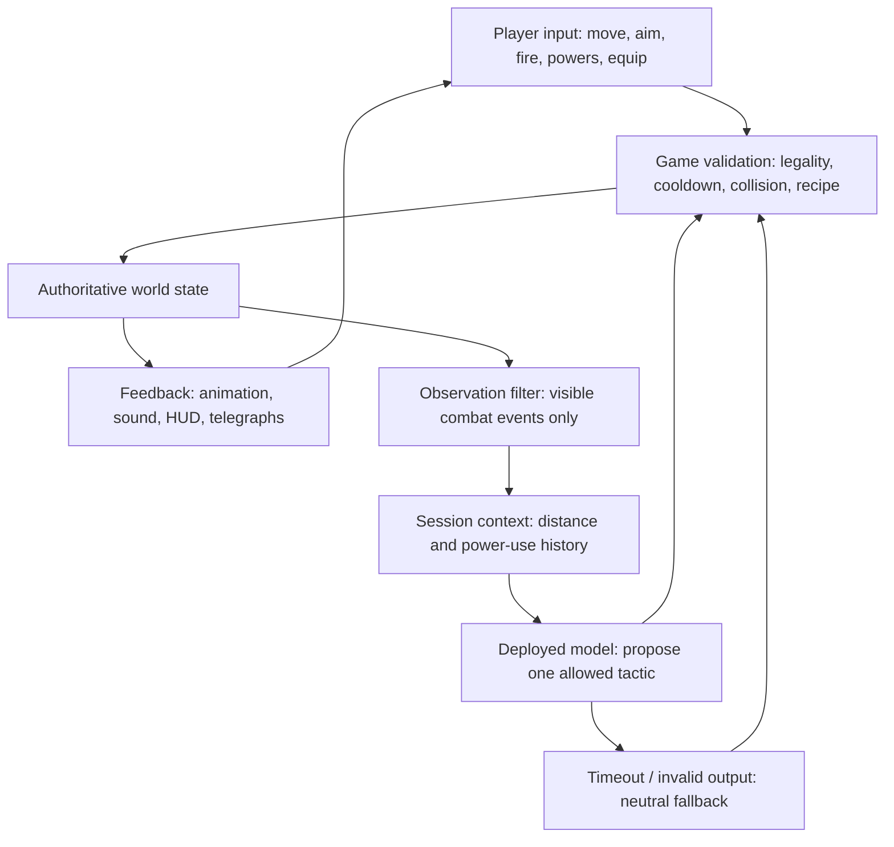

# Initial Configuration Document
Version 0.2 · November 15, 2026 · G1 planned configuration

**Status:** all Overload executable paths and commands below are planned interfaces, not existing implementation. Midterm source inspection establishes available patterns, not verified reuse in this new game. Human owner: Adit, Executive Producer and Creative Director. Gate approver: instructor.

## Stack and reuse
Proposed desktop client: Python 3.11/3.12, pygame-ce, uv, pytest and Ruff. Original top-down simulation and placeholder art. Proposed service: Cloudflare Worker / Agents SDK foundation, TypeScript, with per-session state and server-side provider access. Vertex AI is preferred because it matches the course-funded midterm path. Do not copy local Application Default Credentials into a client or assume they work in a Worker. Validate an approved server-side Vertex authentication path during the deployment spike. Another deployment platform requires instructor permission.

Inspect/reuse design patterns from Adit-Prabhu/abuse_remake at ac1e2ba0a9b44b99a66a68c20102599591d7bbc1: provider response normalization, observation/action validation, replay logging, explicit live-run gates, common agent manifest and independent review. The existing CI uses midterm-specific paths and repository guards. Rewrite those for the final. The current failure behavior refuses an action, so it must change to the final game's deterministic fallback. Do not carry over original Abuse levels/art or assume gameplay code is reusable.

## Systems and knowledge boundary

World state includes exact health, positions, inventory, cooldowns, hidden rooms and RNG state. Observation filtering, not prompting, prevents hidden information from entering model context. The model gets no direct world handle. Its service stores only filtered history and request/budget metadata, separated by opaque server-issued session ID. No cross-session retrieval or shared conversational memory.

## In-game extension manifest (planned)
| Required field | Planned specification |
| --- | --- |
| Purpose | Choose the rival's tactic for the next encounter using observed habits |
| Executable artifact | `worker/src/rival.ts` and `POST /sessions/:id/tactic`. JSON/function-calling equivalent. Common manifest `agent-config.json` |
| Available tools | `select_tactic(tactic_id, evidence_ids)` only. No repository, browsing, arbitrary execution or direct game-state tools |
| Prohibited actions | Change stats, invent moves, inspect hidden inventory, read another session, start additional requests, reveal secrets or override validation |
| Named context sources | `src/overload/observations.py:summary`, authored `config/tactics.json`, previous accepted tactic and visible event IDs for this session |
| Retrieval | None at G1 scope. No RAG or external knowledge retrieval |
| Memory | Last two encounter summaries only. Each <= 300 tokens. Reset on new session. Expire service state after 30 minutes inactivity |
| Model | Proposed `gemini-3.5-flash-lite`, Vertex global, following the current course README and midterm config. Confirm availability before implementation. Log requested and resolved model IDs |
| Settings | Temperature 0. Structured JSON. Input ceiling 1,000 tokens including system/schema. Output ceiling 512 billed tokens including thinking. No automatic continuation. No retry. Validate model support |
| Prompt | “Select one allowed next-encounter tactic from the supplied catalogue using only observed history. Return tactic_id and evidence_ids as JSON. Do not invent evidence or change game rules. With insufficient evidence select lateral.” |
| Failure modes | Timeout, provider refusal/error, invalid JSON, unknown tactic/evidence ID, wrong session/request ID, stale reply, repeated profile fixation, budget exhaustion, leaked context |
| Evaluation cases | Boundary invariance, session isolation, invalid-action rejection, timeout, stale reply, supported tactic selection on synthetic histories, repetition/stuck regression, full win/loss path |
| Logging | Anonymous session ID, encounter/request ID, config and prompt hash, requested/resolved model, filtered-context hash, accepted proposal, fallback reason, latency and token/cost estimate. No credentials or unnecessary participant data |
| Human override | Human approves model/config/spend, can disable live mode or stop evaluation, decides changes and merges. Runtime disable uses deterministic fallback |
| Test command | Planned `uv run pytest`. Worker `npm test`. No billable requests in deterministic checks |
| CI workflow | Planned `.github/workflows/overload-checks.yml`. Deterministic checks on every PR. Live evaluation separate and explicitly authorized |

## State transitions and validation
Encounter 1 starts with the neutral profile. When it ends, freeze a filtered summary and send at most one request for encounter 2 while the player is in the safe-room menu. Repeat once for encounter 3. Do not block active combat. On Continue, wait only until the original five-second request deadline. Use fallback if unavailable. At most two paid attempts in a ten-minute session, including failures. Retry of an encounter reuses its accepted tactic without another request.

Validate schema, tactic enum, evidence IDs actually provided, session identity, encounter index, request ID, deadline, update count and budget reservation. Unknown evidence invalidates the proposal. No output can change stats or unlock content. After validation, authored controllers execute the selected tactic. They use current visible position or bounded last-seen search. Restore memory/tactic snapshots on retry.

Baseline: identical simulation, profiles, stats and unlocks, but a predeclared tactic schedule ignores history. Baseline does not call a model. Record timing differences as a confound. Test participants may notice waiting. Use an equal minimum safe-room transition in both and log additional waits/fallbacks. Optional third condition: a simple adaptive rule to assess whether the LLM adds value beyond adaptation itself.

## Budgets with explicit basis
These are planning allocations, not Overload benchmarks or current provider quotes.

| Item | Target / bound | Basis |
| --- | --- | --- |
| Rendering | 60 FPS / 16.7 ms frame | 1000/60. Profile target laptop. Model work never runs on frame thread |
| Successful model response | p95 <= 3 seconds | Engineering target informed only loosely by midterm smoke p95 1.69 s. New network/deployment/context must be measured |
| Hard response deadline | 5 seconds | Discard stale replies and use neutral tactic. Zero retries |
| Session calls | <= 2 attempts | Three encounters, two transitions. Failures consume attempts |
| Token allowance | <= 2,000 input + 1,024 output | Two requests x 1,000 input and 512 output. Count billed thinking, reserve before dispatch |
| Model planning estimate | $0.00316/session | Midterm's dated Oct 26 planning rates: $0.30/M input and $2.50/M output, computed as 0.002 x 0.30 + 0.001024 x 2.50 |
| Model spending allowance | $0.01/session | Conservative reserved limit. Check current price/model and token counting before any live calls |
| Hosting allowance | $5/month reserved | Assumption, not a plan quote. Amortized over 100 sessions = $0.05/session. Unused/free-tier capacity reduces actual cost |
| Combined allowance | $0.06/session at 100 sessions/month | $0.01 model reservation + $0.05 hosting allocation. Lower usage increases allocated hosting cost/session |
| Live eval cap | $1/gate suite | Count attempted/failed requests. Reserve worst-case cost before dispatch. Stop if usage unknown until reconciled |

These exclude human labor, hardware and development-assistant subscriptions. Unknown-usage failures remain reserved at their worst-case allowance, not reported as free. Billing reconciliation and provider token counting are open implementation tasks. Do not claim that cancelling a request reverses billing. Reprice and remeasure before live evaluation. No paid call has run for this proposal.

## Production-agent role coverage
All artifacts below are planned executable task/agent configurations. Shared models are allowed, but roles and handoffs remain distinct. Developer agents have repository context. The in-game rival never does. Adit retains every accountable Owner role, creative decisions and resource commitments. The instructor alone approves gates.

| Role / planned artifact | Purpose and context | Tools / permissions | Output and handoff | Evaluation / human approval |
| --- | --- | --- | --- | --- |
| Producer · `.agents/producer.md` | Scope, dependencies and risks. GDD, plan, Asana exports | Read docs. Propose task updates. No deadline or gate changes | Prioritized plan to Adit and Tech Lead | Check capacity/dependencies. Adit accepts commitments |
| Design Lead · `.agents/design.md` | Rules, fusion and playtest questions. GDD and observations | Edit design drafts and test cases. No silent scope expansion | Rule spec to Tech/Art/QA | Trace a valid session. Adit accepts creative direction |
| Tech Lead · `.agents/tech.md` | Client, service and deployment. Config and approved tasks | Branch-local code/tests. No merges, tags or paid calls without authorization | Runnable change and traces to QA | CI and contract tests. Adit accepts integration |
| Art Lead · `.agents/art.md` | Legibility, shape language and minimal assets. Design and asset manifest | Create original assets. Inspect screenshots. No unlicensed downloads | Asset/spec set to Tech and QA | Check tells at play size, color-independent cues. Adit approves art |
| Narrative · `.agents/narrative.md` | Minimal premise and labels. Only public story facts | Edit bounded text. No invented gameplay promises | Labels and short rival identity to Design/Tech | No hidden-state disclosure. Adit approves text |
| Audio · `.agents/audio.md` | Distinct shot, hit and cue sounds. Event list and rights manifest | Generate simple original effects. No external samples without terms | Event-to-audio map to Tech/QA | Mute behavior and cue checks. Adit approves audio |
| QA · `.agents/qa.md` | Independent failure reproduction. Diff, contracts and test plan | Read-only review and test execution. No implementation edits in review | Blocking findings to Adit/Tech | Regression, isolation and fallback evidence. Adit resolves findings |
| BI · `.agents/bi.md` | Latency/cost and player evidence. Anonymized logs | Read logs, write analysis. No reclassifying failed runs | Bounded comparison report to Design/Producer | Recompute from raw data. Adit approves interpretation |
| Publishing / Release · `.agents/release.md` | Access, reproducibility and archive. Approved build and manifest | Prepare packaging/instructions. No publish/tag without human decision | Release checklist and package to Adit | Fresh-machine run and link access. Adit approves release, instructor approves Gold |

Each native role config will include bounded task instructions, required inputs, expected outputs and review criteria, with a common-manifest entry. G1 plans them. G2/G3 records working roles and gaps. G4 records complete coverage and actual use. No claim of a functioning agent team is made yet.

## Harness plan
Deterministic PR tests: rule invariants, one valid terminal path, illegal action leaves state unchanged, invalid fusion/teleport, actual observed regression once found, timeout and stale reply, request cap, two concurrent sessions with disjoint histories, and hidden-state changes under identical observations leave prompts unchanged. Mocked replies test plumbing only.

Live suite: six authored observation histories x three repeats, capped at 18 attempts per suite, with model/settings/config versions, accepted/invalid outcomes, evidence relevance, latency, tokens, estimated cost and unavailable runs. Run small live checks after prompt/model/tool/memory/permission changes and fuller suite before gates. Human review scores relevance using the visible evidence. Any automated judge must be checked against human judgments. Replays prove reproducibility of recorded runs, not current model capability.

## Open questions
Confirm final repository and pinned dependency versions, prove Worker-to-Vertex authentication, verify current model availability/pricing and output cap, and confirm available human hours. Deployment/cost checks are tasks, not blockers to drafting G1. No API keys belong in these documents.
